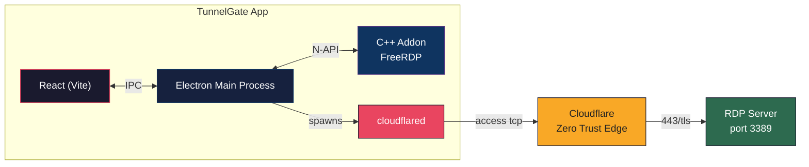
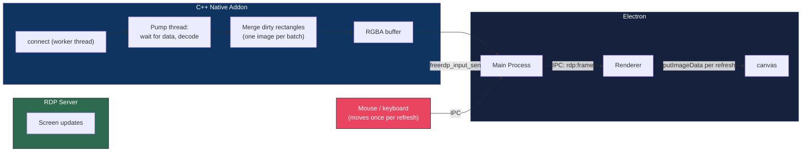

<p align="center">
  
</p>

<h1 align="center">TunnelGate</h1>

<p align="center">
  <strong>One-click RDP through Cloudflare Zero Trust tunnels</strong>
  <br>
  <sub>Built-in FreeRDP viewer &bull; Smooth, low-latency screen &bull; macOS, Windows and Linux</sub>
</p>

<p align="center">
  <a href="https://github.com/RandomKid24/tunnelgate/releases">
    
  </a>
  
  
  
  
  <br>
  
  
  
  
</p>

<p align="center">
  <i>No terminals. No config files. No headache. Pick a server, click connect, and you are on the remote desktop.</i>
</p>

---

## ✨ What's new in 2.2.3

- **Updates install themselves.** TunnelGate checks for a new release on launch and every few hours, downloads it in the background, and shows a banner with **Restart & install** when it is ready. If you ignore it, it installs on the next quit. This starts with 2.2.3, so older versions need one manual download first.
- **Signed and notarized on macOS.** Releases are signed with a Developer ID certificate and notarized by Apple, so the app opens with a normal double-click: no "damaged" warning and no `xattr` workaround.

## ✨ What's new in 2.2

A major overhaul of the interface and of how the remote screen is drawn.

- **New interface.** Rebuilt on the [befui](https://befui.vercel.app/) component set with light, dark and system themes (light by default), a new sidebar and a consistent layout on every page.
- **Smoother remote screen.** Screen updates are batched, mouse moves are sent once per screen refresh, the network loop waits for data instead of polling, and the remote is drawn at window size with smooth scaling.
- **Connect and disconnect never freeze the app.** The native work runs off the main thread, so the window stays responsive during the handshake.
- **One-click disconnect.** The toolbar **Disconnect** button ends the session and drops the tunnel.
- **Mac keyboard that works.** <kbd>Cmd</kbd>+<kbd>C</kbd>/<kbd>V</kbd>/<kbd>X</kbd>/<kbd>A</kbd>/<kbd>Z</kbd> act as <kbd>Ctrl</kbd> shortcuts inside the remote session.
- **macOS Location helper.** An **Open Settings** button next to the Wi-Fi status jumps straight to the Location Services pane.
- **More resilient.** A renderer error boundary replaces blank-window crashes with a Reload screen, and the update check now points at the right repository.

---

## ✨ Features

| | Feature | Details |
|---|---|---|
| 🚀 | **One-click Connect** | Tunnel + RDP in a single click via `cloudflared access tcp` |
| 🖥️ | **In-app RDP Viewer** | FreeRDP rendering into an Electron `<canvas>`, no external client needed |
| 📐 | **Window-size Resolution** | The remote desktop is sized to your window and follows `DesktopResize` events |
| 🪟 | **True Fullscreen** | Native Fullscreen API hides OS chrome; the toolbar reveals on hover |
| 🎨 | **Light / Dark / System theme** | Picked from the top bar, remembered between launches |
| 📋 | **Clipboard sync** | Text copy and paste between your machine and the remote (FreeRDP 3 builds) |
| 🔐 | **Zero Plaintext Secrets** | Passwords encrypted at rest with Electron `safeStorage` (DPAPI / Keychain / libsecret) |
| 📶 | **Wi-Fi gate** | Optionally restrict connections to approved networks |
| 🪟 | **Native Client Fallback** | Launch `mstsc.exe` (Windows) or Microsoft Remote Desktop (macOS) with pre-filled credentials |
| 🔔 | **Auto-update** | Downloads new releases in the background and installs them on restart |
| ⌨️ | **Esc goes to the session** | <kbd>Esc</kbd> is forwarded to the remote desktop; in fullscreen it exits fullscreen |
| 🌍 | **Cross-Platform** | macOS (Apple Silicon), Windows x64, Linux x64 |

---

## 📥 Download

Grab the latest installer from the [Releases page](https://github.com/RandomKid24/tunnelgate/releases):

| Platform | File |
|---|---|
| macOS (Apple Silicon) | `TunnelGate-arm64.dmg` |
| Windows x64 | `TunnelGate-Setup-x64.exe` |
| Linux x64 | `TunnelGate-x86_64.AppImage` or `TunnelGate-amd64.deb` |

Once installed (2.2.3 or later), the app updates itself. Releases whose title says **Beta** or **Stable** are labelled so you can pick the one you want. On macOS 2.2.3+ is notarized and opens normally; for older, unsigned builds that show an "app is damaged" warning, run `xattr -cr /Applications/TunnelGate.app` (see [macOS notes](#macos-code-signing-workarounds)).

---

## 🧠 Architecture

### System Overview



### RDP Rendering Pipeline



---

## 🚀 Quick Start

### Prerequisites

| Component | macOS | Windows | Linux |
|---|---|---|---|
| **Node.js** | `brew install node` | [Download](https://nodejs.org/) 18+ | `apt install nodejs npm` |
| **cloudflared** | Fetched automatically by `npm run build:all` (pinned + checksummed in `scripts/fetch-cloudflared.js`) and bundled into the packaged app, no separate install | | |
| **FreeRDP** | `brew install freerdp` (FreeRDP 3) | Included via `prebuilt/windows-x64/` (no install needed) | `apt install freerdp3-dev` |
| **Build Tools** | Xcode CLI: `xcode-select --install` | VS 2022 BuildTools + cmake + vcpkg | `build-essential` + cmake |

### Install & Run

```sh
git clone https://github.com/RandomKid24/tunnelgate.git
cd tunnelgate
npm install
npm run build:all     # builds C++ addon + compiles TypeScript + bundles Vite
npm run dev           # Vite dev server + Electron with hot reload
```

> **Windows note**: If `npm run dev` has a PowerShell escape issue, use separate terminals:
> ```sh
> # Terminal 1
> npm run dev:renderer
> # Terminal 2
> npm run dev:main
> ```

### Typechecking

`npm run build` only typechecks the main and preload processes. Typecheck the renderer too before committing UI changes:

```sh
npx tsc -p tsconfig.json --noEmit          # renderer + shared
npx tsc -p tsconfig.main.json --noEmit     # main
npx tsc -p tsconfig.preload.json --noEmit  # preload
```

### Error Monitoring

TunnelGate initializes `pq-befu` in the Electron main process. Set these variables in the main-process launch environment:

```sh
PQ_API_KEY=your_pq_api_key
PQ_BASE_URL=http://localhost:8000   # optional; this is the default
NODE_ENV=development                # or production
```

Never expose `PQ_API_KEY` through renderer or Vite environment variables. The renderer reports errors through the preload bridge as `window.pq`, while the API key stays in the main process.

### Package for Distribution

```sh
# macOS: DMG
npm run build:all && npx electron-builder --mac

# Windows: NSIS installer
npm run build:all && npx electron-builder --win

# Linux: AppImage + .deb
npm run build:all && npx electron-builder --linux
```

### Releases

Every push to `main` builds all three platforms in CI and publishes a GitHub release. The release tag comes from the `version` in `package.json`; bump it for each real release so the tag, installer and in-app version all match. A repeat of an existing version gets a `-build.N` suffix.

**Auto-update needs a version bump.** The in-app updater (`electron-updater`, `src/main/updater.ts`) compares the `version` in `package.json`, not the tag, so a release only reaches users if its version is higher than theirs. It reads `latest-mac.yml` / `latest.yml` / `latest-linux.yml` and the macOS **zip** from the release, so the workflow uploads `*.zip` and `latest*.yml` alongside the installers. Updates only run in packaged builds, never in `npm run dev`.

**macOS signing in CI.** The macOS job imports a Developer ID certificate, signs every binary in `build/afterPack.mac.js`, notarizes the app with `notarytool` and staples the ticket. It needs these repository secrets: `MAC_CERT_P12` (base64 `.p12`), `MAC_CERT_PASSWORD`, `SIGN_IDENTITY` (`Developer ID Application: Name (TEAMID)`), `APPLE_ID`, `APPLE_APP_SPECIFIC_PASSWORD` and `APPLE_TEAM_ID`. Without `MAC_CERT_P12` the job falls back to an ad-hoc signed build.

---

## 🧩 How It Works

1. **Add a tunnel**: enter hostname, username and password (encrypted at rest via OS-level crypto)
2. **Click connect**: the app spawns `cloudflared access tcp --hostname <host> --url localhost:<port>`
3. **Tunnel ready**: once `cloudflared` prints the "ready" signal, the in-app RDP viewer starts
4. **RDP negotiation**: the C++ addon connects via FreeRDP with NLA (HYBRID) security and TLS encryption, on a worker thread so the UI never blocks
5. **Frame rendering**: FreeRDP decodes into a GDI buffer; changed regions are merged and sent as RGBA to a React `<canvas>` over IPC
6. **Interaction**: keyboard and mouse events are forwarded through the tunnel to the RDP server
7. **Fullscreen**: the native Fullscreen API hides all OS chrome; the toolbar stays reachable on hover
8. **Disconnect**: the toolbar **Disconnect** button tears down the RDP session and the tunnel. <kbd>Esc</kbd> is not a disconnect key: it is forwarded to the remote desktop, or exits fullscreen

---

## 🔐 Security

| Measure | Detail |
|---|---|
| **Password storage** | Encrypted with Electron `safeStorage`: DPAPI (Windows), Keychain (macOS) or libsecret (Linux) |
| **No disk plaintext** | Passwords are decrypted in memory only at connection time |
| **No shell injection** | All processes are spawned with `argv` arrays, never shell strings |
| **Hostname validation** | Strict regex before any connection attempt |
| **Electron hardening** | `contextIsolation: true`, `nodeIntegration: false` |
| **No credential logging** | Passwords are never written to log files or console output |

---

## 🛠 Development

### Notes on the renderer

- UI components live in `src/renderer/components/ui/` (vendored [befui](https://befui.vercel.app/): Radix + CVA + Tailwind v4). Import them as `@/components/ui/<name>`.
- Theming is in `src/renderer/hooks/useTheme.ts`. The `dark` class on `<html>` drives befui's `dark:` variant; the remote desktop view stays dark in light mode.
- `vite.config.mts` must keep its `.mts` extension because `@tailwindcss/vite` is ESM-only.

### RDP session resolution

The app measures the RDP container with `ResizeObserver` and subtracts the toolbar height so the canvas fills the space below it. The remote is requested at window size (CSS pixels), clamped to 640×480 … 3840×2160, and drawn with smooth scaling on high-DPI screens. When the server reports a resolution change through FreeRDP's `DesktopResize` callback, the canvas and GDI buffer are resized to match.

### Tuning and debugging the RDP engine

| Variable | Effect |
|---|---|
| `TG_RDP_TRACE=1` | Full packet-level FreeRDP logging (large log files; off by default) |
| `TG_RDP_GFX=1` | Opt in to the FreeRDP graphics pipeline (H.264). Experimental, off by default |
| `TG_RDP_HIDPI=1` | Ask Windows to scale its UI to your display scale. Experimental, off by default |

### macOS code signing workarounds

#### Signed release builds

Set `SIGN_IDENTITY`, `APPLE_ID`, `APPLE_APP_SPECIFIC_PASSWORD` and `APPLE_TEAM_ID` (and `CSC_IDENTITY_AUTO_DISCOVERY=false` so `electron-builder` does not sign a second time) before `npx electron-builder --mac`. `build/afterPack.mac.js` then signs with the Developer ID certificate in your keychain, notarizes, and staples. `SIGN_IDENTITY` must start with `Developer ID Application:`; an Apple Development certificate is rejected by notarization. Without `SIGN_IDENTITY` the build is ad-hoc signed for local use. Keep these values in an untracked file such as `.env.release`.

#### "App is damaged" Gatekeeper fix (unsigned builds only)

Notarized releases (2.2.3+) do not need this. If an ad-hoc signed or older build is marked as damaged by Gatekeeper:

```sh
xattr -cr /Applications/TunnelGate.app
```

This removes the `com.apple.quarantine` attribute macOS sets on downloaded apps.

#### Build without signing

```sh
CSC_IDENTITY_AUTO_DISCOVERY=false npm run build:all && npx electron-builder --mac --dir
```

#### Electron Framework corruption (macOS 26+ "Tahoe")

On macOS 26 and later, `electron-builder`'s built-in ad-hoc signing corrupts the `Electron Framework` binary during packaging. `build/afterPack.mac.js` handles signing instead, so do not enable `electron-builder`'s native signing. To repair a bundle by hand, replace the Framework binary from `node_modules/electron/dist` and re-sign:

```bash
# 1. Replace the corrupted Framework binary with the original
cp node_modules/electron/dist/Electron.app/Contents/Frameworks/Electron\ Framework.framework/Versions/A/Electron\ Framework \
   release/mac-arm64/TunnelGate.app/Contents/Frameworks/Electron\ Framework.framework/Versions/A/Electron\ Framework

# 2. Deep re-sign the entire app bundle
codesign --deep --force --sign - --options runtime \
   --entitlements build/entitlements.mac.plist \
   release/mac-arm64/TunnelGate.app
```

### Windows: OpenSSL legacy provider

On Windows, FreeRDP 3 requires the OpenSSL **legacy provider** for RC4 during the RDP licensing handshake. The C++ addon and `bootstrap.ts` automatically:

1. Write a minimal `openssl.cnf` at runtime
2. Set `OPENSSL_MODULES` and `OPENSSL_CONF` before the addon loads
3. Load the `legacy` + `default` providers before any connection

`legacy.dll` is deployed alongside the addon in the `ossl-modules/` subdirectory during the build step.

#### Prebuilt Windows DLLs

CI-compiled FreeRDP DLLs crash inside `gdi_init_ex` because of MSVC environment differences. The known-good Windows DLLs are committed to `prebuilt/windows-x64/`, and `build-native.js` copies them automatically.

> **Updating DLLs:** build locally on Windows, verify RDP works, then copy `native/rdp-addon/build/Release/*.dll` (and `ossl-modules/`) into `prebuilt/windows-x64/` and commit.

See [`docs/TUNNELGATE_COMPLETE.md`](docs/TUNNELGATE_COMPLETE.md) for the full deep-dive on the bugs resolved during development.

---

## 📁 Project Structure

```
prebuilt/
└── windows-x64/           # Known-working Windows FreeRDP DLLs (committed)
src/
├── main/                  # Electron main process
│   ├── bootstrap.ts       # FIRST import: sets PATH & env vars before the addon loads
│   ├── ipcHandlers.ts     # IPC channel registration
│   ├── rdpViewManager.ts  # Addon bridge, clipboard bridge, Mac shortcut forwarding
│   ├── tunnelManager.ts   # cloudflared spawn/kill lifecycle
│   ├── updater.ts         # electron-updater: check, download, install-on-restart
│   ├── credentialStore.ts # safeStorage encrypt/decrypt wrapper
│   └── store.ts           # electron-store persistence
├── renderer/              # React frontend (Vite)
│   ├── App.tsx            # Root component
│   ├── views/             # Servers, Tunnels, Logs, Settings, RdpView, Login
│   ├── components/        # RdpCanvas, ErrorBoundary, ThemeMenu, BrandMark, ui/ (befui)
│   └── hooks/             # useTheme, useLogs, ...
├── preload/               # Context bridge (exposes IPC to the renderer)
├── native/rdp-addon/      # C++ FreeRDP addon (cmake-js, N-API)
│   ├── rdp_session.h/.cpp # connect, pump loop, GDI updates, clipboard
│   └── rdp_module.cpp     # N-API entry point, async connect/disconnect
└── shared/                # Shared TypeScript types
scripts/
├── build-native.js        # cmake-js builder, copies prebuilt DLLs / dylibs
└── fetch-cloudflared.js   # downloads the pinned, checksummed cloudflared
```

---

## 📚 Documentation

| Doc | Description |
|---|---|
| [`docs/RDP_NATIVE_ADDON.md`](docs/RDP_NATIVE_ADDON.md) | C++ addon architecture, FreeRDP API usage, rendering pipeline, clipboard wiring, known bugs |
| [`docs/TUNNELGATE_COMPLETE.md`](docs/TUNNELGATE_COMPLETE.md) | Complete project reference: components, IPC flow, error codes, CI/CD |
| [`docs/REPLICATE_FROM_SCRATCH.md`](docs/REPLICATE_FROM_SCRATCH.md) | Standalone guide to rebuild the project from zero |

---

## 🤝 Contributing

PRs are welcome. If you find a bug or have a feature request, [open an issue](https://github.com/RandomKid24/tunnelgate/issues).

**Before submitting a PR:**

1. Run `npm run build` and the three `tsc --noEmit` commands above
2. Test on your target platform
3. Update docs if your change affects the interface or the build process

---

## 📄 License

MIT. See [LICENSE](LICENSE).

---

<p align="center">
  
  <br>
  <sub><strong>forged by beforth</strong></sub>
  <br>
  <sub>Made with ❤️ for remote workers everywhere.</sub>
  <br>
  <sub>Not affiliated with Cloudflare, Microsoft, or FreeRDP.</sub>
</p>
